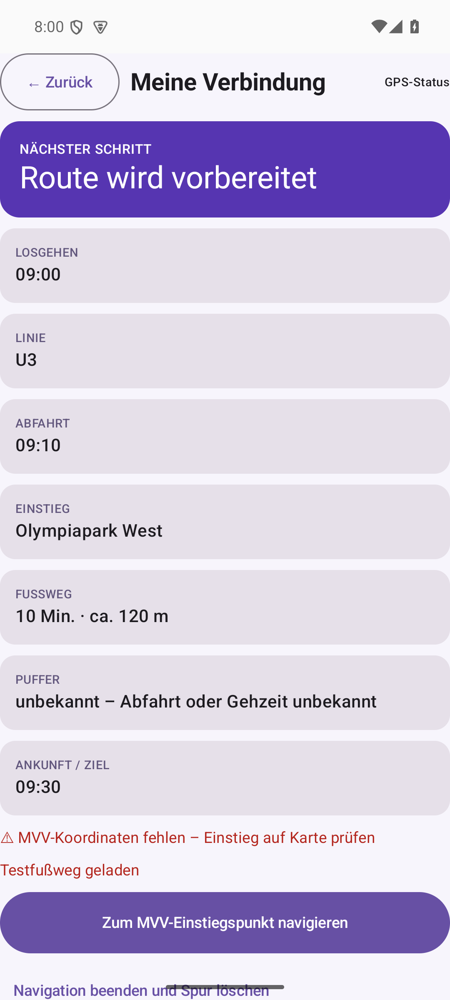
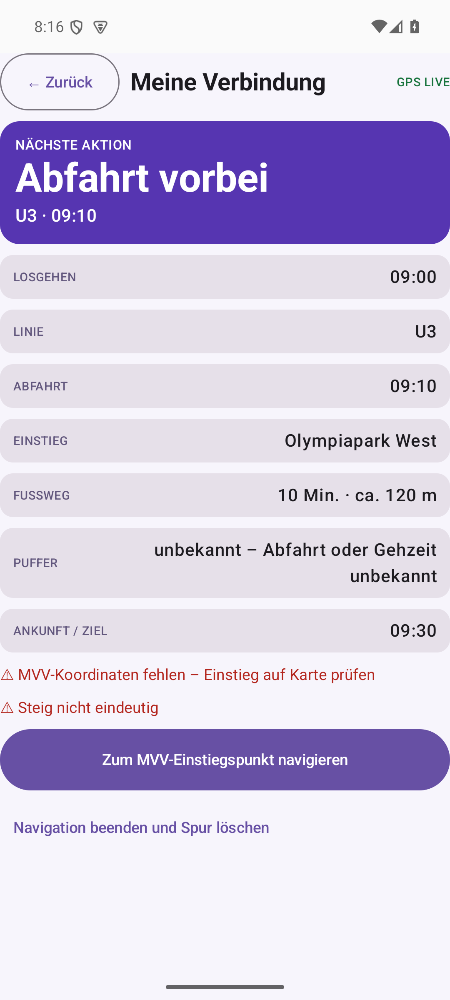

# Visuelle Gegenprüfung – Dashboard Design 5 (Issue #20)

**Datum:** 26.11.2026 · **Referenz:** [dashboard-design-5-kompakt.svg](../dashboard-design-5-kompakt.svg)

## Vorher / Nachher (tatsächlich gerendert, API-35-Emulator)

| Vorher (alte Vollbildimplementedierung) | Nachher (angeglichen) |
| --- | --- |
|  |  |

Beide Bilder stammen aus `adb exec-out screencap -p` im Fixture-Modus
(`mein_weg_test_fixture=true`, QA-Extra `mein_weg_test_fullscreen=dashboard`).
Die Werte im Fixture sind Beispieldaten und werden nicht als Live-Werte ausgegeben.

## Abgleich mit der SVG-Referenz

| Kriterium der Referenz | Umsetzung |
| --- | --- |
| Kompakter Header „Meine Verbindung", Zurück, GPS-Status | Vorhanden; GPS-Status jetzt aus `navigationLocation` abgeleitet (`GPS LIVE` / `GPS veraltet`) statt Platzhaltertext |
| Dominanter Countdown für die nächste Aktion mit Kontext/Uhrzeit | Große Anzeige `Noch X Min. bis Abfahrt/Anschluss` inkl. Linie und Uhrzeit; bei fehlender Grundlage `Zeitpunkt unbekannt`, bei vergangener Abfahrt `Abfahrt vorbei` |
| Kompakte Karten in der Reihenfolge Linie/Abfahrt → Einstieg → Fußweg/Puffer → Ziel | Als flache Zeilen mit fester Labelbreite; kein umbrechendes Label mehr |
| Primäraktion „Zum MVV-Einstiegspunkt navigieren" | Vollflächig, deutlich unter den Daten, nicht überdeckt |
| Warnungen (Koordinaten, Steig, GPS) sichtbar | Eigene, rot markierte Zeilen; reiner Status (z. B. „Testfußweg geladen") wird nicht mehr als Warnung eingefärbt |
| Keine App-Bottom-Navigation, Android-Statusleiste sichtbar | Erfüllt; Systemnavigation bleibt bedienbar |
| Debug-Export nicht prominent | Im Vollbild-Dashboard nicht enthalten |
| Keine abgeschnittenen Aktionen | Unterer Abstand ergänzt; „Navigation beenden"-Aktion vollständig sichtbar |

## Verifikation

- Compose-Instrumentierung: `fullscreenDashboardShowsDynamicJourneyState` prüft Vollbild, dynamische Werte und das Fehlen der App-Tab-Leiste; `captureFullscreenDashboardForDesignReview` erzeugt einen reproduzierbaren Screenshot.
- `:app:connectedDebugAndroidTest`: 38 Tests, 0 Fehler auf API 35 (inkl. Rotation und #19-Datumstest).
- Golden-Screenshots in `design/golden/` wurden nach der Änderung neu erfasst; `scripts/compare-golden.py` besteht.

**Grenze:** Die Gegenprüfung erfolgte auf dem Emulator. Für eine echte S25/Geräteabnahme liegen weiterhin keine Screenshots vor; diese Ticketabnahme ist eine Emulator-Sichtprüfung gegen die versionierte SVG.
